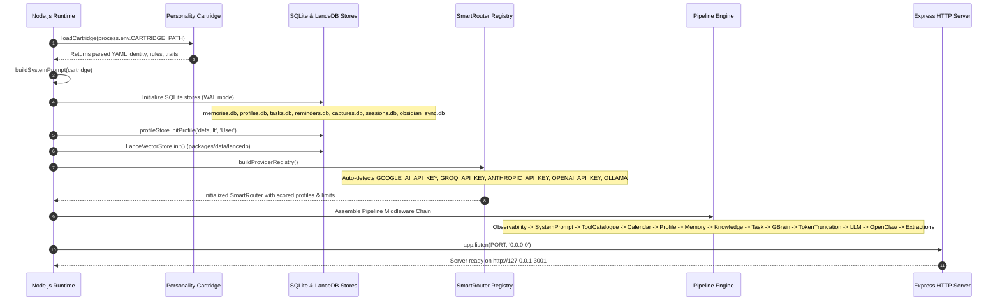
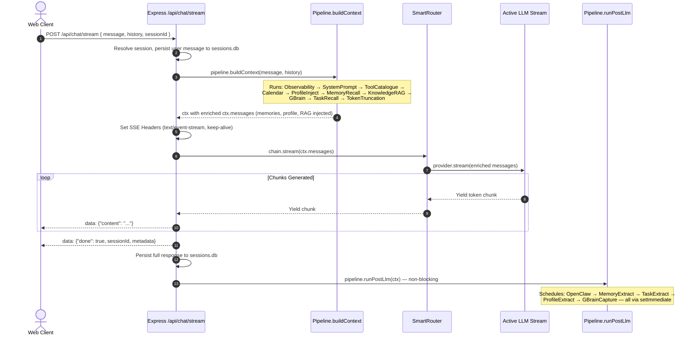
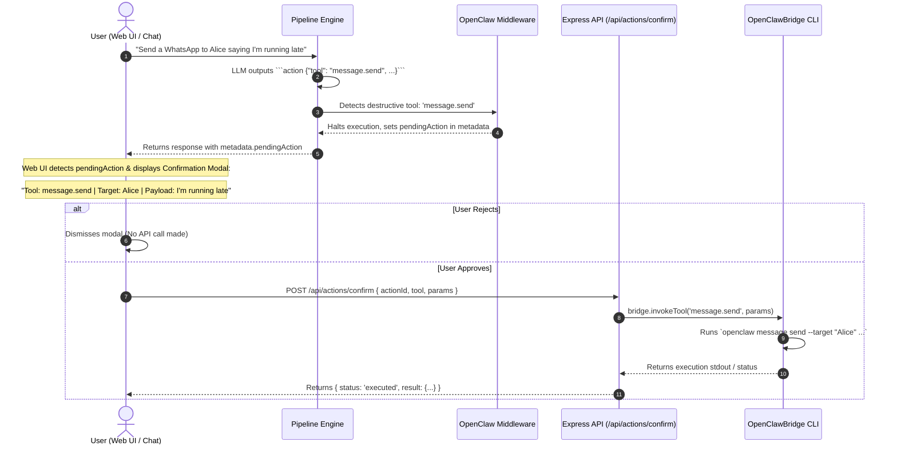
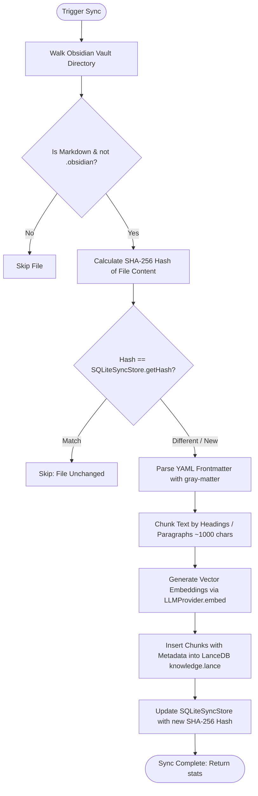
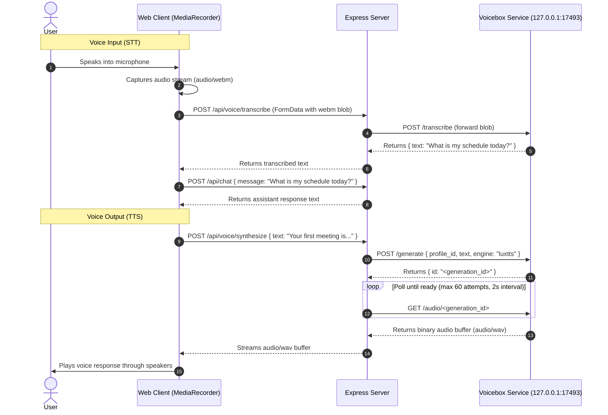
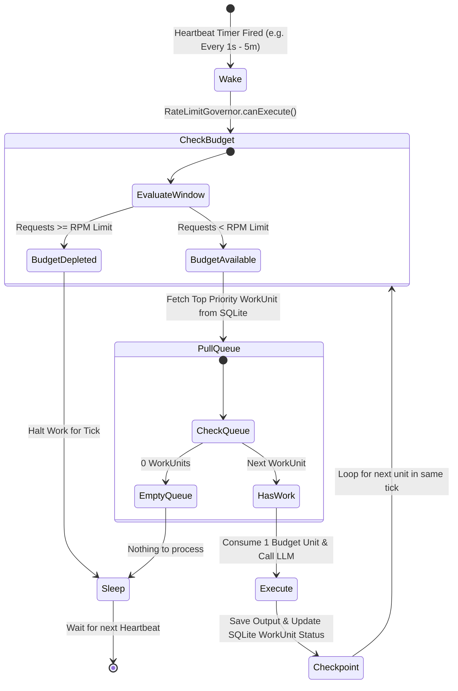

# J.A.R.V.I.S — End-to-End Execution Flow Architecture

This document provides a comprehensive technical breakdown of the complete execution flow across the entire J.A.R.V.I.S platform, detailing how requests move through the frontend, API gateway, middleware pipeline, intelligence router, knowledge stores, tool execution bridges, and background extraction loops.

---

## 1. System Topology & Component Map

The J.A.R.V.I.S workspace is structured as a modular TypeScript monorepo managed via `pnpm` workspaces, with persistent local-first storage:

```
┌───────────────────────────────────────────────────────────────────────────────┐
│                              CLIENT INTERFACES                                │
│                                                                               │
│   Next.js 15 PWA (`packages/web`)          OpenClaw Bridge (`skills/`)        │
│   - Chat UI & Session Switcher             - WhatsApp / Telegram Channels     │
│   - Voice Recorder (Web Audio API)         - OS Notification & Agent Hooks    │
│   - Tool Confirmation Modals                                                  │
└───────────────────────┬───────────────────────────────┬───────────────────────┘
                        │ HTTP / JSON / SSE             │ HTTP POST
                        ▼                               ▼
┌───────────────────────────────────────────────────────────────────────────────┐
│                       EXPRESS API GATEWAY (`packages/api`)                    │
│                                                                               │
│   Endpoints:                                                                  │
│   - `POST /api/chat` & `/api/chat/stream`     - `POST /api/actions/confirm`   │
│   - `GET  /api/sessions[/:id/messages]`       - `POST /api/knowledge/sync`    │
│   - `GET/PATCH /api/profile`                  - `POST /api/voice/transcribe`  │
│   - `GET/PATCH /api/tasks` & `/reminders`     - `POST /api/voice/synthesize`  │
│   - `GET/DELETE /api/memories`                - `GET  /api/providers`         │
└───────────────────────────────────────┬───────────────────────────────────────┘
                                        │
                                        ▼
┌───────────────────────────────────────────────────────────────────────────────┐
│                    UNIFIED PIPELINE ENGINE (`pipeline.ts`)                    │
│                                                                               │
│  [1. Observability] ──► [2. System Prompt] ──► [3. Tool Catalogue]           │
│           ▲                                            │                      │
│           │                                            ▼                      │
│  [6. Memory Recall] ◄── [5. Profile Injection] ◄── [4. Google Calendar]       │
│           │                                                                   │
│           ▼                                                                   │
│  [7. Knowledge RAG] ──► [8. Task Recall] ────► [9. GBrain Think]             │
│                                                        │                      │
│                                                        ▼                      │
│                                           [10. Token Truncation]              │
│  ─ ─ ─ ─ ─ ─ ─ ─ ─ ─ ─ ─ markLlmBoundary() ─ ─ ─ ─ ─ ─ ─ ─ ─ ─ ─ ─ ─ ─   │
│  (SSE stream splits here: buildContext stops / runPostLlm runs post-LLM)     │
│                                                        │                      │
│                                                        ▼                      │
│  [12. OpenClaw Tool] ◄── [11. SmartRouter LLM] ────────┘                     │
│           │                                                                   │
│           ▼                                                                   │
│  [13. Memory Write*] ──► [14. Task Write*] ──► [15. Profile Write*]          │
│                                                        │                      │
│                                                        ▼                      │
│                                           [16. GBrain Capture*]              │
│  (* = async, fire-and-forget via setImmediate — never blocks response)       │
└───────────────────────────────────────┬───────────────────────────────────────┘
                                        │
                    ┌───────────────────┴───────────────────┐
                    ▼                                       ▼
┌───────────────────────────────────────┐ ┌─────────────────────────────────────┐
│       STORAGE LAYER (`data/`)         │ │      INTELLIGENCE & SERVICES        │
│                                       │ │                                     │
│ - SQLite WAL Databases:               │ │ - `SmartRouter` & Provider Registry │
│   * `sessions.db`  (Chats & History)  │ │   (Gemini, Groq, Claude, OpenAI,    │
│   * `memories.db`  (FTS5 Facts)       │ │    Ollama Local / Cloud)            │
│   * `profiles.db`  (User Persona)     │ │ - `OpenClawBridge` (OS/Web CLI)     │
│   * `tasks.db` & `reminders.db`       │ │ - `ObsidianCrawler` (Vault RAG)     │
│   * `captures.db`  (Scratchpad)       │ │ - `Voicebox` (LuxTTS & STT engine)  │
│   * `obsidian_sync.db` (Sync Hashes)  │ │ - Personality Cartridge (`.yaml`)   │
│ - LanceDB (`knowledge.lance` vectors) │ │                                     │
└───────────────────────────────────────┘ └─────────────────────────────────────┘
```

---

## 2. Boot & Initialization Lifecycle

When `pnpm --filter @jarvis/api dev` boots (`packages/api/src/index.ts`):



1. **Cartridge Loading**: Reads `packages/config/jarvis-personality.yaml` through `loadCartridge()`. Enforces Paul Bettany JARVIS tone (dry British wit, conciseness, no filler phrases, opinionated recommendations).
2. **Database Provisioning**: All SQLite stores initialize with WAL mode (`PRAGMA journal_mode = WAL`) and automatic DDL migrations in `packages/data/`.
3. **Provider Auto-Discovery**: Reads environment variables to configure active providers with tiered RPM/RPD limits and task capability score matrices (General, Coding, Reasoning, Creative, Quick, Tool Use).
4. **Knowledge Store Initialization**: Connects to LanceDB table `knowledge.lance` for semantic vector search.
5. **Express Server Startup**: Binds to `0.0.0.0:3001` with CORS enabled for `packages/web` (running on `http://localhost:3000`).

---

## 3. End-to-End Request Flow (`POST /api/chat`)

This is the primary conversational execution loop. Every incoming message passes through a deterministic lifecycle with an async write path that never blocks the HTTP response:

```mermaid
flowchart TD
    Start([User sends message]) --> SessionResolution[1. Resolve Session & Persist to sessions.db]
    SessionResolution --> PipeRun[2. Pass into pipeline.run]

    subgraph Pre-LLM Context Enrichment
        PipeRun --> ObsPre[3. Observability Start: Timer & Token Counter]
        ObsPre --> SysPrompt[4. System Prompt: Personality + Real-time Clock]
        SysPrompt --> ToolCat[5. Tool Catalogue: Inject Available Tools JSON Spec]
        ToolCat --> CalCheck{6. Google OAuth Token?}
        CalCheck -- Yes --> FetchCal[Fetch Today's Events from Google Calendar API]
        CalCheck -- No --> ProfInject
        FetchCal --> ProfInject[7. Profile Injection: Inject Preferred Name & User Context]
        ProfInject --> MemRecall[8. Memory Recall: FTS5 Query against memories.db]
        MemRecall --> RagCheck{9. Query > 10 chars?}
        RagCheck -- Yes --> RagQuery[Query Vector Embeddings in LanceDB Vault]
        RagCheck -- No --> TaskRec
        RagQuery --> TaskRec[10. Task Recall: Query Pending Tasks & Reminders]
        TaskRec --> GBrainCheck{11. GBRAIN_ENABLED?}
        GBrainCheck -- Yes --> GBrainThink[Run gbrain think CLI]
        GBrainCheck -- No --> Truncate
        GBrainThink --> Truncate[12. Token Truncation: Trim History to fit Context Window]
    end

    subgraph LLM Inference & Dynamic Routing
        Truncate --> Classify[13. SmartRouter Heuristic Classification: quick / coding / tool_use / reasoning]
        Classify --> CheckLimits{Provider Under Rate Limit?}
        CheckLimits -- Yes --> ExecuteLLM[Dispatch prompt to primary provider]
        CheckLimits -- No --> FailoverLLM[Failover to next capable provider]
        ExecuteLLM --> RawOutput[Generate raw LLM response]
        FailoverLLM --> RawOutput
    end

    subgraph Action Verification & Execution
        RawOutput --> ActionCheck{Contains action block?}
        ActionCheck -- Safe Action web.search --> AutoExec[Execute via OpenClaw CLI & Synthesize Follow-up]
        ActionCheck -- Destructive os.exec message.send --> BlockAction[Halt Pipeline, set pendingAction]
        ActionCheck -- No Action --> RespSet[Set context.response]
        AutoExec --> RespSet
        BlockAction --> RespSet
    end

    RespSet --> HTTPResponse([Return JSON Response to Client])
    HTTPResponse --> PersistAssistant[Persist Assistant Response in sessions.db]

    subgraph Async Write Path — Fire and Forget via setImmediate
        PersistAssistant --> MemExtract[14. Memory Extraction: parseMemoryOutput — validated categories]
        MemExtract --> TaskExtract[15. Task Extraction: parseTaskOutput — validated action types]
        TaskExtract --> ProfExtract[16. Profile Extraction: parseProfileOutput — Zod-equivalent JSON validation]
        ProfExtract --> GBrainCapture[17. GBrain Capture: Save Markdown note to GBrain via stdin]
    end

    GBrainCapture --> ObsPost[18. Observability Wrap-up: Log timing, tokens & memories]
```

> [!IMPORTANT]
> **Async write path**: Steps 14–17 (all extraction middlewares) run via `setImmediate` — they are scheduled _after_ the HTTP response is flushed. The user never waits for memory, task, or profile writes. Failures in this path log warnings but never surface as errors.

---

## 4. Pipeline Middleware Deep-Dive

Each middleware in `packages/api/src/engine/` performs a single, isolated responsibility:

### 1. `observabilityMiddleware`
- **Location**: `engine/observability.ts`
- **Execution**: Wraps the entire lifecycle.
- **Action**: Starts `performance.now()`. Computes input token heuristics. Upon return, calculates total latency, input/output tokens, and prints a structured CLI terminal card:
  ```text
  ╭─── Request #42 ───────────────────────────────────
  │ Time:    2026-10-25T11:00:00.000Z
  │ Input:   "What meetings do I have and check my notes on LanceDB"
  │ Output:  "You have 2 meetings today..."
  │ Tokens:  ~142 in / ~89 out
  │ Memory:  3 recalled, 1 extracted
  │ Time:    1842ms
  ╰───────────────────────────────────────────────────
  ```

### 2. `systemPromptMiddleware`
- **Location**: `engine/pipeline.ts`
- **Execution**: Pre-LLM
- **Action**: Prepends the static personality prompt (`packages/config/jarvis-personality.yaml`) and injects dynamic temporal context:
  ```markdown
  ## System Information
  Current Date and Time: Sunday, October 25, 2026, 4:30:00 PM GMT+5:30
  ```

### 3. `toolCatalogueMiddleware`
- **Location**: `engine/tool-catalogue.ts`
- **Execution**: Pre-LLM
- **Action**: Injects tool descriptions into system prompt when `OPENCLAW_ENABLED=true`:
  - `web.search`: Search the live web via OpenClaw gateway.
  - `os.exec`: Run shell commands (**Destructive** — requires confirmation).
  - `file.read`: Read filesystem contents safely.
  - `file.write`: Write files (**Destructive** — requires confirmation).
  - `message.send`: Send WhatsApp/Telegram messages (**Destructive** — requires confirmation).
  - Formats required JSON response schema: ````action {"tool": "...", "params": {...}} ````.

### 4. `calendarMiddleware`
- **Location**: `engine/calendar-middleware.ts`
- **Execution**: Pre-LLM
- **Action**: Reads `preferences.google_refresh_token` from `profiles.db`. If present, calls Google Calendar API v3 to list events between `now` and `endOfDay`. Injects:
  ```markdown
  ## Upcoming Events Today:
  - 10:00 AM - 10:30 AM: Sprint Planning
  - 02:00 PM - 03:00 PM: 1:1 with Engineering Lead
  ```

### 5. `profileInjectionMiddleware`
- **Location**: `engine/profile-middleware.ts`
- **Execution**: Pre-LLM
- **Action**: Loads profile `default` from `SQLiteProfileStore`. Injects user's preferred name, role, location, timezone, interests, and preferences into the prompt.

### 6. `memoryRecallMiddleware`
- **Location**: `engine/memory-middleware.ts`
- **Execution**: Pre-LLM
- **Action**: Sanitizes the user query into SQLite FTS5 syntax (`"word1" OR "word2"`), queries `memories_fts`, retrieves top 5 relevant facts, and injects them under `## Relevant Memories`.

### 7. `knowledgeMiddleware` (Obsidian Vault RAG)
- **Location**: `engine/knowledge-middleware.ts`
- **Execution**: Pre-LLM
- **Action**:
  1. Computes vector embedding for user query via `llm.embed(query)`.
  2. Queries `LanceVectorStore` table `knowledge` for the 4 nearest neighbor document chunks.
  3. Injects retrieved chunks into system context with strict anti-hallucination guardrails:
     ```markdown
     ## Verified Personal Knowledge (Obsidian Vault)
     You must use ONLY these notes to answer the query. If the answer is not present,
     output: "I do not have sufficient information in my memories to answer that."
     --- File: Projects/JARVIS.md (Tags: #ai, #agent) ---
     ...
     ```

### 8. `taskRecallMiddleware`
- **Location**: `engine/task-middleware.ts`
- **Execution**: Pre-LLM
- **Action**: Queries `tasks.db` for status `'pending'` (top 5) and `reminders.db` for pending reminders (top 3). Injects them as actionable system awareness.

### 9. `gbrainMiddleware`
- **Location**: `engine/gbrain-middleware.ts`
- **Execution**: Pre-LLM
- **Action**: If `GBRAIN_ENABLED=true`, spawns `gbrain think "<userMessage>"` CLI subprocess to synthesize historical knowledge across people, companies, and timeline events, injecting the synthesized output into context.

### 10. `tokenTruncationMiddleware`
- **Location**: `engine/token-middleware.ts`
- **Execution**: Pre-LLM (Final safety checkpoint)
- **Action**: Counts total characters across all messages. If estimated tokens exceed 6,000 (to protect models like Gemma or 8K context windows), iteratively drops the oldest dialogue turns while strictly preserving all system prompt blocks and the latest user prompt.

### 11. `llmCallMiddleware` & `SmartRouter`
- **Location**: `engine/pipeline.ts` & `engine/SmartRouter.ts`
- **Execution**: Core Model Generation
- **Action**:
  1. **Classification**: Fast zero-token heuristic regex classifies prompt into `quick`, `coding`, `reasoning`, `creative`, `tool_use`, or `general`.
  2. **Budget Verification**: Checks candidate providers against RPM, RPD, and daily token limits.
  3. **Ranking**: Computes weighted scores (`score = taskScore * 0.4 + latencyScore * 0.3 + costScore * 0.3`).
  4. **Dispatch**: Sends request to best available adapter (`OpenAICompatibleAdapter`, `AnthropicAdapter`, `OpenAIAdapter`, `OllamaAdapter`).
  5. **Circuit Breaker / Failover**: If the selected provider throws 429 or 5xx, trips cooldown timer and falls back to the next model in the registry.

### 12. `openclawActionMiddleware`
- **Location**: `engine/openclaw-middleware.ts`
- **Execution**: Post-LLM Execution & Agency
- **Action**:
  - Scans response for ````action` blocks or raw tool JSON.
  - If tool is **Safe** (`web.search`, `file.read`):
    - Invokes `OpenClawBridge.invokeTool(tool, params)`.
    - Appends tool output to conversation messages.
    - Triggers follow-up LLM completion (`chain.chat()`) so the assistant synthesizes the result.
  - If tool is **Destructive** (`os.exec`, `file.write`, `message.send`):
    - Pauses execution, removes action markdown from visible response.
    - Sets `context.pendingAction = { id, tool, params, safetyTier: 'destructive' }`.
    - Client UI displays an Interactive Confirmation Card with parameters.

### 13. Post-LLM Extraction Middlewares (Write Path — Async Fire-and-Forget)

All four extraction middlewares wrap their LLM call + store write inside `setImmediate(async () => { ... })`. The HTTP response has already been sent by the time any of these run. Failures are logged as `[*:bg]` warnings and never propagate to the user.

**Output validation** is handled by `engine/llm-output.ts` — a zero-dependency schema validator that:
- Strips markdown code fences and surrounding prose from LLM output
- Finds and extracts the outermost `{...}` JSON block via brace-matching
- Auto-repairs common small-model failures (trailing commas before `}` or `]`)
- Validates each field by type — unknown types are dropped, not propagated
- Applies content length sanity bounds (min/max chars per field)

| Middleware | Parser | Store |
|---|---|---|
| `memoryExtractionMiddleware` | `parseMemoryOutput()` — validates `[category] content` lines, enforces 6 known categories | `memories.db` |
| `taskExtractionMiddleware` | `parseTaskOutput()` — validates `[action_type] content` lines, enforces 4 known action types, 3–500 char bounds | `tasks.db`, `reminders.db`, `captures.db` |
| `profileExtractionMiddleware` | `parseProfileOutput()` — validates JSON structure, coerces all preference values to strings, runs every 5 turns | `profiles.db` |
| `gbrainExtractionMiddleware` | No LLM output parsing — pipes formatted Markdown to `gbrain capture --stdin` | GBrain note store |

---

## 5. Streaming Execution Flow (`POST /api/chat/stream`)

For real-time low-latency UI experiences, JARVIS provides Server-Sent Events (SSE). The streaming endpoint now has **full pipeline parity** with `/api/chat` — all pre-LLM enrichment steps (memory recall, profile injection, RAG, task recall, token truncation) run before the stream opens, and post-LLM extraction runs asynchronously after the stream closes.

This is enabled by two new `Pipeline` methods:
- **`pipeline.buildContext(message, history)`** — runs all middleware up to `markLlmBoundary()`. Returns enriched `ctx.messages` with memories, profile, calendar, RAG chunks, task list injected.
- **`pipeline.runPostLlm(ctx)`** — runs all middleware after the boundary (skips `llmCallMiddleware` itself). All extractors use `setImmediate` internally, so this call returns immediately.



> [!NOTE]
> The `markLlmBoundary()` call in the pipeline assembly is what enables this split. It records the index of `llmCallMiddleware` in the middleware array. `buildContext` runs indices `0…boundary-1`; `runPostLlm` runs indices `boundary+1…end` (skipping the LLM call itself, since the stream handler has already done it via `chain.stream`).

**SSE event format:**
```
data: {"content": "token chunk"}\n\n   ← repeated for each chunk
data: {"done": true, "sessionId": "...", "metadata": {"memoriesRecalled": 3, "ragSources": [...]}}\n\n
```

---

## 6. Action Confirmation & Security Flow

JARVIS enforces strict human-in-the-loop security for destructive operations (shell execution, filesystem modifications, messaging):



---

## 7. Knowledge Ingestion Flow (`ObsidianCrawler`)

The external Obsidian vault is synchronized into the vector search database on-demand or via scheduled crawl (`POST /api/knowledge/sync`):



---

## 8. Voice Interaction Pipeline (Voicebox STT/TTS)

JARVIS supports hands-free, bidirectional voice conversations via Voicebox integration:



---

## 9. Tick-Based Autonomous Execution Loop

To execute long-horizon research and background extraction without exceeding API rate limits, JARVIS employs a tick-based heartbeat loop:



### Key Principles of the Tick Loop
- **Idempotent Work Units**: Tasks (e.g., summarizing an article, verifying a contradiction) carry inputs, cursors, and priority. Crashing mid-tick loses at most one unit.
- **Rolling Window Governor**: Prunes timestamps older than the window, rejecting work when the bucket is full.
- **Run Lock (`isRunning`)**: Prevents overlapping execution if an async LLM call exceeds the tick interval duration.

---

## 10. Data Persistence & File System Layout

All state is stored locally within `packages/data/` for privacy, speed, and zero external database dependencies:

| File / Store | Engine / Format | Schema / Description |
| :--- | :--- | :--- |
| `packages/data/sessions.db` | SQLite (WAL) | `sessions` (id, title, created_at, updated_at)<br>`messages` (id, session_id, role, content, metadata, created_at) |
| `packages/data/memories.db` | SQLite (WAL) + FTS5 | `memories` (id, content, category, metadata, timestamps)<br>`memories_fts` (FTS5 virtual table + sync triggers) |
| `packages/data/profiles.db` | SQLite (WAL) | `profiles` (id, name, preferred_name, preferences, context, version, timestamps)<br>`profile_history` (versioned diff snapshots) |
| `packages/data/tasks.db` | SQLite (WAL) | `tasks` (id, description, status, priority, due_date, tags, timestamps) |
| `packages/data/reminders.db` | SQLite (WAL) | `reminders` (id, description, trigger_time, trigger_context, completed, timestamps) |
| `packages/data/captures.db` | SQLite (WAL) | `captures` (id, content, category, processed, timestamps) |
| `packages/data/obsidian_sync.db` | SQLite (WAL) | `file_sync` (file_path, file_hash, last_synced_at) |
| `packages/data/lancedb/` | LanceDB (Vector) | Vector table `knowledge`: `[id, vector(1536), text, fileName, tags, mtime]` |

---

## 11. Summary of Execution Guarantees

1. **Non-Blocking Resilience**: If Google Calendar fails, LanceDB is unavailable, or a memory query times out, each middleware catches errors gracefully with warnings and continues the conversation.
2. **Context Window Protection**: The `tokenTruncationMiddleware` guarantees that long dialogue histories will never trigger context overflow crashes on small or local models.
3. **Safety by Default**: Destructive tool actions (`os.exec`, `file.write`, `message.send`) can **never** execute without explicit user approval through the confirmation API.
4. **Zero Vendor Lock-in**: All models implement the `LLMProvider` interface (`packages/shared/src/adapters/LLMProvider.ts`). SmartRouter automatically chooses the most cost-effective and capable provider available at runtime.
5. **Async Write Path**: All post-LLM extraction (memory, task, profile, GBrain) runs via `setImmediate` — fire-and-forget after the HTTP response or SSE stream closes. Response latency is never impacted by write-path LLM calls.
6. **Validated LLM Outputs**: All extraction middlewares use `engine/llm-output.ts` parsers (`parseMemoryOutput`, `parseTaskOutput`, `parseProfileOutput`). Malformed JSON, unknown categories, missing braces, trailing commas, and out-of-bounds content are silently dropped — never written to stores. Small/quantised models cannot corrupt the database.
7. **Stream Pipeline Parity**: `/api/chat/stream` applies the same pre-LLM enrichment (memory recall, profile injection, RAG, task recall, token truncation) as `/api/chat`. Streamed responses are indistinguishable from non-streamed responses in terms of context quality.
